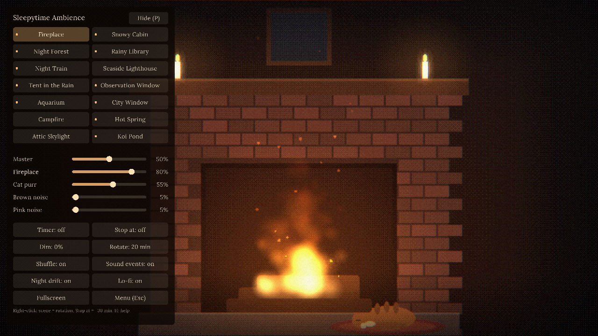

# Sleepytime Ambience

Cozy lo-fi ambient scenes for falling asleep, fully offline. The pictures are drawn live and the sounds are
recordings stored on disk, so nothing streams and nothing stops when the internet drops. Fourteen scenes, each with
its own mix of sound layers, plus a sleep timer, screen dimming and auto-rotate.

## Install (Windows 10 or 11)

1. On the [Releases page](https://github.com/dontdoubtdusty/sleepytime_ambience/releases/latest), download `SleepytimeAmbience-<version>-win-x64.zip`.
2. Right-click the zip, choose **Extract All...**, then **Extract**. Running it from inside the zip will not work.
3. Open the extracted folder and double-click `SleepytimeAmbience.exe`.
4. If Windows shows "Windows protected your PC", click **More info**, then **Run anyway** (once only).

Updates: when a new version is out, a note appears shortly after starting. Click **Update** and it installs and
restarts by itself; settings are kept.

Uninstall: delete the folder, and `%APPDATA%\SleepytimeAmbience` to remove settings.

## Usage

Move the mouse to show the control panel; it hides after 3 seconds. Press Esc for the menu (guide, shortcuts,
updates, screenshots folder, reset settings, quit) and H for the full shortcut list. Settings save automatically.

| Key | Action |
|---|---|
| 1-9, 0, F1-F4 / Tab | Switch scene |
| Up / Down | Master volume |
| Left / Right, PgUp / PgDn | Pick a sound layer, change its volume |
| T / U | Sleep timer / stop at a clock time (fades out, then quits) |
| D | Dim screen |
| F / F11 | Fullscreen |
| R | Auto-rotate scenes |
| N | Night drift: slowly dims and quiets over 2.5 hours |
| F12 | Save a screenshot to `Pictures\Sleepytime Ambience` |

## Known limits

- Windows 10/11 x64 only.
- The app is not signed, so Windows warns on first run.
- Scenes are drawn at 640x360 and scaled up, so they look soft on large screens (on purpose), with black bars on
  screens that are not 16:9.
- Windows will not go to sleep while the app is open; use the sleep timer if you want it to stop.
- The update check needs internet; everything else works offline.
